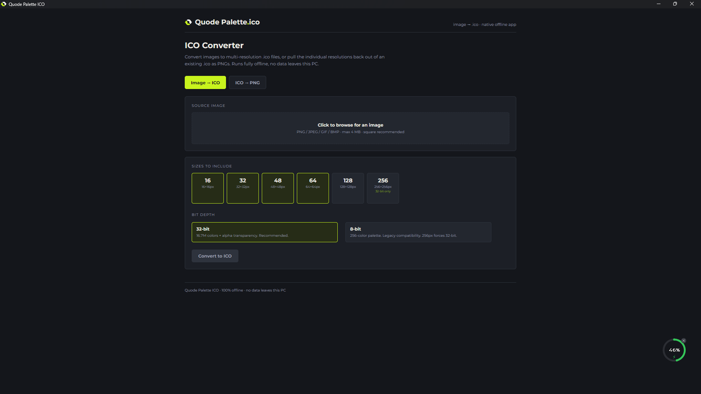
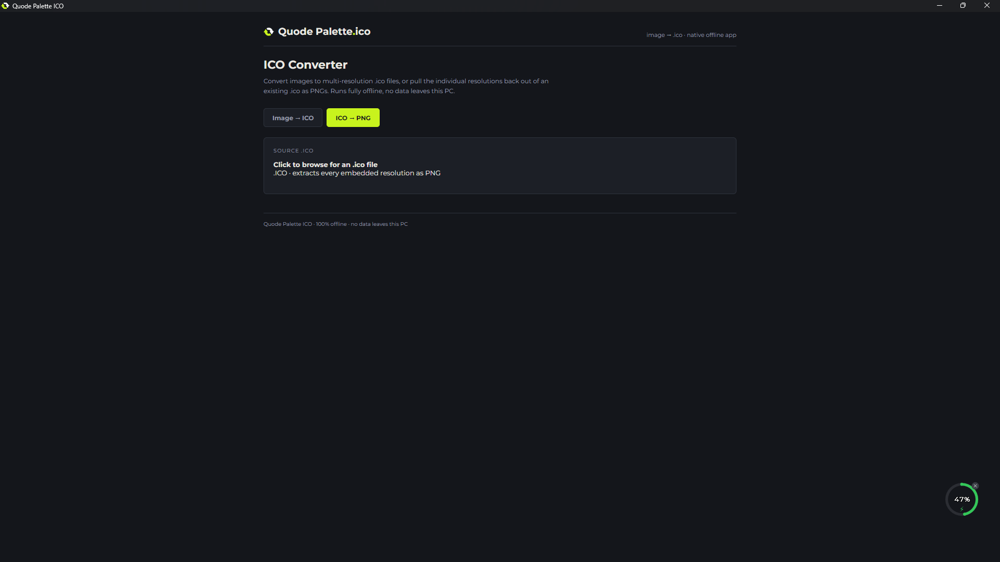

# Quode Palette ICO

A small offline tool for creating Windows icon files and extracting images from existing ICO files.

  

  

## Features

- Convert PNG, JPEG, GIF, and BMP images into multi-size `.ico` files.
- Choose the icon sizes and color depth to include.
- Extract each image size from an `.ico` file as a PNG.
- Save one PNG or export all extracted sizes to a folder.
- Work offline. Images stay on your computer.

## Fonts

The font is under the SIL Open Font License.

## License

Released under the [PolyForm Noncommercial License 1.0.0](LICENSE). You are free to use, modify and share it for personal, educational and other noncommercial purposes. For commercial use, please get in touch.
[Email Us](mailto:hello@quodepalette.com)